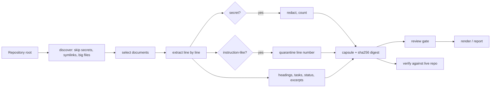

# 03. Architecture

## System context

```text
 Developer ──► contextsutra CLI ──reads──► approved repository root (docs, ADRs, manifests)
                    │
                    ├─writes──► capsule.json, handoff.md, report.md/html, audit.*
                    │
                    └─copies──► .claude/skills, .cursor/skills, .agents/skills, ...   (skills only)

 Host IDE / assistant  ◄── user attaches handoff.md or invokes a skill with the host's own method
 Optional: loopback HTTP server (127.0.0.1) serves one capsule with a bearer token
```

Trust boundaries: everything read from the repository is untrusted data. The CLI never talks to a model, never calls the network, and never executes repository code.

## Containers and modules

| Module | File | Responsibility | Side effects |
|---|---|---|---|
| Guards | `packages/core/guards.mjs` | Path safety, secret and injection patterns, redaction | None (pure) |
| Capsule | `packages/core/capsule.mjs` | Discover, extract, build, validate, freshness, diff, render | Reads files |
| Analyze | `packages/core/analyze.mjs` | Decisions, tasks, conflicts, privacy review | None (pure) |
| Reporters | `packages/reporters/*` | Markdown to HTML, report, shared theme | None (pure) |
| Audit | `packages/audit/audit.mjs` | Known-answer and fixture checks | Temp files only |
| Server | `packages/server/index.mjs` | Loopback read-only endpoint | Listens on 127.0.0.1 |
| CLI | `packages/cli/index.mjs` | Argument parsing, I/O, exit codes, install | Writes requested outputs |

Pure logic is separated from I/O so each part can be tested alone.

## Data flow: scan to hand-off



## Capsule schema (v1)

Top-level keys: `schema`, `tool`, `project`, `scan`, `sources[]`, `privacy`, `trust`, `narrative`, `integrity`. See the [technical reference](04-technical-reference.md) and `schemas/capsule.schema.json`.

## Integrity model

`integrity.digest` is SHA-256 over a canonical JSON form (keys sorted). It detects edits when you hold a trusted copy of the digest. Anyone who edits a capsule can recompute it, so it is **not** a signature (`integrity.signed` is `false`). Signing is on the roadmap.

## Server model

Loopback only, GET only, `/health` open and `/capsule` behind a bearer token compared by hash with `timingSafeEqual`. Host header must be `127.0.0.1`, `localhost` or `[::1]` (DNS-rebinding guard). Not a production service: no TLS, tenancy or audit log.

## Skills model

12 Markdown skills in `skills/portable/`. Each skill calls only real CLI commands through `npx contextsutra`. Copying them to a host directory is a file copy; whether the host loads them is verified separately and currently recorded as untested.

## Quality attributes

| Attribute | Mechanism |
|---|---|
| Safety | Allow-list of document types; deny-list of names; no symlink follow; bounded sizes |
| Reproducibility | Sorted traversal, canonical JSON, no timestamps inside the digest |
| Supply chain | Zero dependencies; no install scripts |
| Portability | `path` handling for Windows separators; CI on three operating systems |
